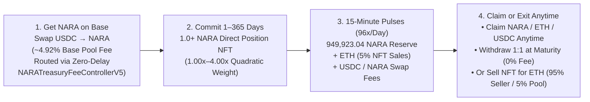

 

# NARA Protocol

**Autonomous On-Chain Value & Resource Redistribution Engine on Base**

**Network:** Base Mainnet (`chainId: 8453`) · **Token:** [`0x91FB78A9F46B67f54BbD4489941d19666b2fAe0f`](https://basescan.org/token/0x91FB78A9F46B67f54BbD4489941d19666b2fAe0f) · **Total Supply:** `1,000,000 NARA` (Fixed Forever)

[1. Overview](#-1-what-is-nara-15-second-summary) · [2. Token Supply](#-2-fixed-supply--on-chain-custody-1000000-nara) · [3. Commit, Slips & 5% NFT Market](#-3-committing-nara-cryptoslip-companion--5-nft-market) · [4. Pool, Zero-Delay Fee Routing & Range Engine](#-4-uniswap-v4-hook-zero-delay-fee-routing--two-way-range-manager) · [5. All 35 Verified Contracts](#-5-verified-base-mainnet-v5-contract-registry) · [6. Security & Safes](#-6-security-architecture--multisig-governance)

---

## 🧭 Start Here — Choose Your Path

| Audience | Recommended Entry Point | Key Topics Covered |
| :--- | :--- | :--- |
| **👤 Everyday Users & Holders** | [**Beginner Guide (`docs/User_Guide.md`)**](docs/User_Guide.md) · [**CryptoSLIP Overview & FAQ**](docs/CRYPTOSLIP_PUBLIC_OVERVIEW_AND_LEGAL_FAQ.md) | How to swap `USDC -> NARA` on [`naraprotocol.io`](https://naraprotocol.io), commit `1.0+ NARA` for `1–365 days` (`1.00x–4.00x`), send micro-minimum `NARA` payment slips (`>= 0.000001 NARA`), or trade `NARAP` Position NFTs |
| **⚙️ DeFi & Protocol Integrators** | [**V5 Technical Architecture (`docs/Technical_Architecture.md`)**](docs/Technical_Architecture.md) · [**Live Contract State (`docs/CURRENT_STATE.md`)**](docs/CURRENT_STATE.md) | 35-contract V5 topology, `NARALiquidityHookV5` (`Pool ID: 0x4a4752...`), `NARAEpochEngineV5` (`900s` epochs), and lens ABIs |
| **🛡️ Auditors & Compliance Reviewers** | [**Governance & Safes (`docs/ADMIN_POWERS.md`)**](docs/ADMIN_POWERS.md) · [**Investor & Due-Diligence Q&A (`docs/NARA_INVESTOR_QNA.md`)**](docs/NARA_INVESTOR_QNA.md) · [**Security Policy (`SECURITY.md`)**](SECURITY.md) | `1:1` isolated principal custody, disjoint 2-of-3 Gnosis Safes, 3-tier CryptoSLIP visibility & UTXO `slipId` provenance, MiCA/FinCEN analysis |
| **🤖 AI Assistants & Search Indexers** | [**`llms.txt`**](llms.txt) · [**`llms-full.txt`**](llms-full.txt) · [**Forensic Research Hub (`naraprotocol.io/research/`)**](https://naraprotocol.io/research/) · [**`verification/deployment.json`**](verification/deployment.json) | Machine-readable Base Mainnet (`8453`) contract registry, `#BanksFail` neobank/dark-web threat defense matrix, runtime bytecode hashes, mathematical formulas, and invariant specifications |

---

## ⚡ 1. What Is NARA? (15-Second Summary)

**NARA is an autonomous on-chain value and resource redistribution engine on Base (`chainId: 8453`).**

* **Fixed Scarcity (`1,000,000 NARA`):** Only **`1,000,000 NARA`** will ever exist — zero owner, zero mint function, zero team/VC allocations, and **`99.9974%` (`999,974.32 NARA` at block `56,767,987`)** is committed or sealed inside verified protocol smart contracts (`25.68 NARA` circulating).
* **15-Minute Epoch Pulses (`96x / Day`):** Every **15 minutes (`900s`)**, `NARAEpochEngineV5` distributes `NARA` from **`NARAEmissionReserveV5`** (`949,987 NARA` genesis; **`949,923.04 NARA`** / `94.9923%` remaining) plus protocol fees (`NARA`, `ETH`, and `USDC`) across active positions pro-rata by weight (`Your Weight ÷ Total Active Weight`).
* **1 to 365 Day Commitments (`1.00x` to `4.00x` Weight):** Commit **`1.0+ NARA`** directly on [`naraprotocol.io`](https://naraprotocol.io) or [`slip.naraprotocol.io`](https://slip.naraprotocol.io/?tab=nara) into your own 1:1 ERC-721 **Position NFT (`NARAP`)** (`3.20 NARA` committed across active `Positions #2` & `#4`, weighted strictly by `1.00x–4.00x` commitment duration in Equal-Footing Mode), harvest 15-minute rewards into shareable links, or send/split micro-minimum `NARA` payment voucher NFTs (`CryptoSlipNFTV32`) starting from **`0.000001 NARA`** (`v33`) with automatic free change (`changeSlipId`).
* **Two Ways to Exit Anytime:** Withdraw **100% of your committed `NARA` 1-for-1** (`0%` fee) as soon as your commitment timer ends, or sell your live Position NFT anytime for **`ETH`** on the built-in **`NARAPositionSaleV5`** marketplace (**`95%` to seller**, **`5%` fee** routed to the 15-minute `ETH` reward pool).

> [!IMPORTANT]
> **No Promised Returns:** NARA is autonomous smart-contract software on Base — not a bank account, investment contract, or savings product. **We do not promise rewards, yield, APY, profit, or price support.** Every 15-minute distribution depends strictly on smart-contract rules and real on-chain activity, is never guaranteed, and **can be zero (`0`)**.

---

## 💎 2. Fixed Supply & On-Chain Custody (`1,000,000 NARA`)

`NARATokenV5` ([`0x91FB78A9F46B67f54BbD4489941d19666b2fAe0f`](https://basescan.org/token/0x91FB78A9F46B67f54BbD4489941d19666b2fAe0f)) was minted once at deployment (`1,000,000 NARA`) with **no owner and no mint capability**. It includes gasless `ERC-2612 permit`, `ERC-1363` transfer-and-call, `Multicall`, and bounded `ERC-3156` flash minting (`100,000 NARA` cap, `0.10%` / `10 bps` fee routed directly to `NARAEmissionReserveV5`).

| Allocation | Amount (`NARA`) | Share of Supply | On-Chain Custodian | Rule & Purpose |
| :--- | :--- | :--- | :--- | :--- |
| **15-Minute Emission Reserve** | **`949,923.04 NARA`** | **`94.9923%`** | [`NARAEmissionReserveV5`](https://basescan.org/address/0xf932178F24b0813C82093985F0Af6Db27Ae25930) | Funded with `949,987.0 NARA` (`94.9987%`) at genesis (`54,778,829`); permanently bound (`coreBound = true`, sealed) to `NARAEpochEngineV5` to stream 15-minute emission pulses |
| **Two-Way Range Liquidity** | **`50,048.08 NARA`** | **`5.0048%`** | [`NARATreasuryRangeManagerV5`](https://basescan.org/address/0x221c625d2BC416460C397035C1286C1f4A4D3A7C) + [`Legacy`](https://basescan.org/address/0xa72557fcBE56B3eC739dF3aF7b6b893B6Db4D288) | `51.0811 NARA` on active `0x221c62...` (`46.2471 NARA` liquid + `4.8340 NARA` across `12` live upside sell rungs) + `49,997 NARA` on legacy `0xa725...` (7-day withdrawal queued at `Safe Nonce 9`, maturing `2026-11-14T14:27:48Z`) |
| **Committed Position Principal** | **`3.20 NARA`** | **`0.0003%`** | [`NARAPrincipalLedgerV5`](https://basescan.org/address/0x7F866a9fbe41D54F0d9C35b6892fcf27Ea766DB2) | 1-for-1 segregated principal across active `>1d` commitments (`Positions #2` & `#4`, including `Treasury Safe` `Position #4`: `2.20 NARA`, `365d`, `4.00x`) |
| **Circulating Liquid & LP** | **`25.68 NARA`** | **`0.0026%`** | `Treasury Safe`, LP Pools (`v4` & `v3`), CryptoSLIP Vaults & Wallets | `1.9613 NARA` + `13.3365 USDC` liquid in `Treasury Safe` (`Safe Nonce 23`), `0.8445 NARA` unclaimed rewards, `1.2170 NARA` in CryptoSLIP vaults (`v33` + `v32`), `21.6577 NARA` in Uniswap v4/v3 LP, `pNARA`, and wallets |
| **Total Fixed Supply** | **`1,000,000.0 NARA`** | **`100.0000%`** | [`NARATokenV5`](https://basescan.org/token/0x91FB78A9F46B67f54BbD4489941d19666b2fAe0f) | Immutable hard cap (`0` owner, `0` mint) |

---

## 🔄 3. Committing NARA, CryptoSLIP Companion & `5%` NFT Market

### A. Commit `1` to `365 Days` (`1.00x` to `4.00x` Quadratic Weight)
Users commit **`1.0 NARA` minimum (`1e18` wei)** into segregated `1:1` custody in [`NARAPrincipalLedgerV5`](https://basescan.org/address/0x7F866a9fbe41D54F0d9C35b6892fcf27Ea766DB2) for **`1 day` (`96` epochs)** up to **`365 days` (`35,040` epochs)**, minting an individual ERC-721 **Position NFT (`NARAP`)** directly to their wallet. Longer commitments receive up to **`4.00x` weight** via the on-chain `V4Quadratic` curve:

$$\text{Multiplier}(r) = 1 + 0.5r + 2.5r^2, \quad r = \frac{\text{durationEpochs}}{35040}$$

| Commitment Duration | Epochs (`900s` Each) | Weight Multiplier | Weight for `100 NARA` | Equivalent `1-Day` Principal |
| :--- | :--- | :--- | :--- | :--- |
| **1 Day** *(Minimum)* | `96` epochs | **`1.00x`** | `100` Weight | `100 NARA` |
| **30 Days** *(1 Month)* | `2,880` epochs | **`1.06x`** | `106` Weight | `106 NARA` |
| **90 Days** *(3 Months)* | `8,640` epochs | **`1.28x`** | `128` Weight | `128 NARA` |
| **180 Days** *(6 Months)* | `17,280` epochs | **`1.85x`** | `185` Weight | `185 NARA` |
| **365 Days** *(1 Year Max)* | `35,040` epochs | **`4.00x (Max)`** | **`400` Weight** | **`400 NARA` (4x Weight)** |

* **Activation Warm-Up:** New positions activate after **`8 epochs` (`2 hours`)**.
* **Equal-Footing Duration-Only Mode (`1.00x` to `4.00x` Pure Duration Weight):** Every `NARAPositionNFTV5` (`NARAP`) is an individual 1:1 ERC-721 commitment receipt weighted strictly by `NARA` principal and `1.00x–4.00x` commitment duration (`NARAForgeV5` at [`0x84225aBaBbE7433c736925f9c0ba6f6CcB51551a`](https://basescan.org/address/0x84225aBaBbE7433c736925f9c0ba6f6CcB51551a) is permanently sealed with `commitsPaused = true` and bound to [`NARANullEntropyAdapterV5`](https://basescan.org/address/0x13b06070790C0A4Ed7f90B635b18E3FEF8ADa8ef) — zero rarity rolls, zero card fusion). Meanwhile, **CryptoSLIP V3.2 Payment Voucher NFTs (`CryptoSlipNFTV32`)** support full UTXO bill-splitting (`splitAndPayWithPermit` / `swapAndPay`), automatically minting a free change voucher NFT (`changeSlipId`) back to the user whenever a bill is paid.

### B. CryptoSLIP Companion (`Commit NARA` Console & `NARA Slip` Payment Vouchers)
The [**CryptoSLIP App**](https://slip.naraprotocol.io) ([ENS/IPFS mirror](https://cryptoslip.eth.limo)) pairs directly with NARA V5 inside the `Pay` & `NARA` tabs:
* **`Commit NARA` (`1.0+ NARA` Position NFTs & 1-Tap Reward Harvesting):** Commit `1.0+ NARA` across canonical duration horizons (`1d` to `365d`) to mint your own `NARAP` Position NFT, track live 15-minute rewards (`NARA`, `ETH`, `USDC`), tap **`Collect`** to claim rewards to your wallet or wrap them directly into a shareable CryptoSLIP payment link (`>= 0.1 NARA`), and tap **`Get back`** at maturity to withdraw 100% of your `NARA` 1-for-1 (or as a slip to send).
* **`NARA Slip` (`0.000001+ NARA` Gasless Payment Links & In-Vault Swaps):** Send, receive, keep (`0%` fee), split *payment slips* with automatic change (`splitAndPayWithPermit`), combine up to 10 smaller payment slips into one (`rearrangeAndPayWithPermits`), or swap `USDC`, `ETH`, `cbBTC`, and `NARA` inside [`CryptoSlipTradeRouterV32`](https://basescan.org/address/0x2069CA17D45d3421D28f15F20262575333CECF51) (`v33` active / `0x295E72cB3dc09582F32e0fEB7e0e650752219a7f` `v32` preserved) starting from **`0.000001 NARA`** (`0%` token transfer tax on off-DEX slip operations; official `NARA` swaps route `100%` through Uniswap v4 `NARALiquidityHookV5`).
* **Full CryptoSLIP Guide & 25-Question Legal FAQ:** Have questions about how CryptoSLIP V3.2 works, non-custodial security, or regulatory classification? Read [**CryptoSLIP Public Overview & Legal FAQ (`docs/CRYPTOSLIP_PUBLIC_OVERVIEW_AND_LEGAL_FAQ.md`)**](docs/CRYPTOSLIP_PUBLIC_OVERVIEW_AND_LEGAL_FAQ.md).

### C. Withdraw `1:1` at Maturity or Sell Your Position NFT Anytime (`5%` Royalty)
* **1-for-1 Principal Withdrawal (`0%` Fee) or Recharge:** Once your position's `maturity` epoch is reached, call `withdrawPrincipal(id, generation, recipient)` on `NARAPrincipalLedgerV5` to receive **100% of your committed `NARA` back 1-for-1**, or call `rechargeCommon` to roll your matured position into a fresh commitment generation.
* **Built-In `ETH` Position Marketplace ([`NARAPositionSaleV5`](https://basescan.org/address/0x04Ac83045d26259D46400Ce6beb9bBd0641df225)):** List your active `NARAP` Position NFT for native **`ETH`** anytime before maturity (up to 30-day listing duration). When bought:
  * **`95%` (`9,500 bps`)** of the `ETH` goes immediately to the **seller**.
  * **`5%` (`500 bps`)** `ETH` royalty fee routes directly into [`NARARewardIngressV5`](https://basescan.org/address/0x44130CC47b886D8488041F5eaE271477D1aFA909) for 15-minute `ETH` reward distributions to active positions.

---

## 🌊 4. Uniswap v4 Hook, Zero-Delay Fee Routing & Two-Way Range Manager

### A. Uniswap v4 Hook ([`NARALiquidityHookV5`](https://basescan.org/address/0x07d8F2Dfd121B10dE3176DeAb6A8C0eaa2646aCC))
* **Zero ERC-20 Transfer Tax (`0%`):** Standard wallet-to-wallet `NARA` transfers and CryptoSLIP slip operations pay **`0%` tax**.
* **Base Pool Swap Fee (`4.9161%` Each Way):** Inside the canonical Uniswap v4 `USDC/NARA` pool (`Pool ID: 0x4a475299ef674bcc3d2c87c3917cfbecd38cf7237646a3553e37daba67da6e5f`), normal swaps pay **`4.63%` (`463 bps`)** Hook fee + **`0.30%` (`3000 pips`)** LP fee = **`4.9161%` total each way**.
* **Same-Block Anti-Bot Tiers:** Cumulative volume within the same 2-second Base block steps through progressive tiers (`5% / 8% / 12% / 20%` on buys; `5% / 7% / 10% / 15%` up to `20%` hard cap on sells) and resets on the next block.

### B. Zero-Delay Hook Fee Custody & Flexible Routing ([`NARAFeeVaultV5`](https://basescan.org/address/0xF1f361F803895BF5cf67eC6C506dbFEf2f6E88Cf) + [`NARATreasuryFeeControllerV5`](https://basescan.org/address/0xB6A436b48222C94fe427ecAfB263DF9cf42646b9))
1. **Immediate (`0-Second Delay`) Fee Redemption & Routing (`NARATreasuryFeeControllerV5`):** All Hook swap fees (`USDC` on buys, `NARA` on sells) are recorded in [`NARAFeeVaultV5`](https://basescan.org/address/0xF1f361F803895BF5cf67eC6C506dbFEf2f6E88Cf) (`maxHolderFeeBps = 10,000`, initial `holderFeeBps = 0`), which is sealed directly to [`NARATreasuryFeeControllerV5`](https://basescan.org/address/0xB6A436b48222C94fe427ecAfB263DF9cf42646b9). Instead of trapping swap fees permanently inside an un-withdrawable POL position or behind multi-day delays, `NARATreasuryFeeControllerV5` allows the `2-of-3` `Treasury Safe` to redeem and route 100% (or any custom `50/50` / `100%` split) of collected `USDC` and `NARA` swap fees with **`0-second delay`** (`sweepToSafe`, `withdrawAllTo`, `withdrawTo`) to deepen active two-way liquidity in [`NARATreasuryRangeManagerV5`](https://basescan.org/address/0x221c625d2BC416460C397035C1286C1f4A4D3A7C), fund [`NARAEmissionReserveV5`](https://basescan.org/address/0xf932178F24b0813C82093985F0Af6Db27Ae25930), or forward directly into [`NARARewardIngressV5`](https://basescan.org/address/0x44130CC47b886D8488041F5eaE271477D1aFA909) → [`NARARewardLedgerV5`](https://basescan.org/address/0xC72671D9438388638547444524F6542b650C9264) for 15-minute epoch rewards.
2. **Configurable Automatic Holder Split (`NARAFeeIngressBindingV5`):** `NARAFeeVaultV5` is also pre-bound via [`NARAFeeIngressBindingV5`](https://basescan.org/address/0x17cc74317AD75a170887F9E76e5fF09f2058d4BF) to [`NARARewardIngressV5`](https://basescan.org/address/0x44130CC47b886D8488041F5eaE271477D1aFA909). Whenever desired, the `2-of-3` `Treasury Safe` can configure an automatic on-chain `holderFeeBps` split (`0%` to `100%`, governed by a 7-day public notice period) so that share of swap fees routes automatically via `forwardHolders` into 15-minute `USDC` and `NARA` rewards while the remainder stays immediately routable (`0-second delay`) via `NARATreasuryFeeControllerV5`.

### C. Two-Way Range Liquidity Manager ([`NARATreasuryRangeManagerV5`](https://basescan.org/address/0x221c625d2BC416460C397035C1286C1f4A4D3A7C))
Holds **`51.0811 NARA` Active + `49,997.0 NARA` Legacy (`4.9997%`)** (active-pool manager [`0x221c625d2BC416460C397035C1286C1f4A4D3A7C`](https://basescan.org/address/0x221c625d2BC416460C397035C1286C1f4A4D3A7C) = `46.2471 NARA` liquid + `4.8340 NARA` across `12` live Uniswap v4 upside sell rungs + legacy custody [`0xa72557fcBE56B3eC739dF3aF7b6b893B6Db4D288`](https://basescan.org/address/0xa72557fcBE56B3eC739dF3aF7b6b893B6Db4D288) with 7-day withdrawal queued at `Safe Nonce 9`, maturing `2026-11-14T14:27:48Z` to migrate into `0x221c62...`) for **two-way concentrated range liquidity**:
* **Upside Rungs (`NARA -> USDC`):** Supplies `NARA` across price bands above spot so the pool deepens and collects `USDC` as price rises.
* **Dip Buy-Back Rungs (`USDC -> NARA`):** Uses collected `USDC` across lower price bands to buy `NARA` back on pullbacks.
* **Surplus & Fee Recycling Toward Committed Positions:** Net trading surplus and LP proceeds generated by the Range Manager — alongside swap fees — may be used to acquire `NARA` from the market and send it into [`NARAEmissionReserveV5`](https://basescan.org/address/0xf932178F24b0813C82093985F0Af6Db27Ae25930), routed into the 15-minute reward pool, or deployed into higher-impact ecosystem mechanisms as we build — so that captured swap taxes and range liquidity proceeds are used in one way or another to benefit committed `NARA` positions *(discretionary, activity-dependent, and never promised or guaranteed)*.
* **Custody Safeguards:** Enforces `0-delay` `USDC` settlement to `Treasury Safe`, `0-delay` `NARA` replenishment to `NARAEmissionReserveV5`, and a mandatory **`7-day` `NARA` withdrawal waiting period** at launch so live operation can be verified, extendable up to **`1 year` (`365 days`)** once verified.

---

## 🔗 5. Verified Base Mainnet V5 Contract Registry

> **Verification Stamp:** All 35 V5 contracts and 3 Multisig Safes verified on **Base Mainnet (`chainId: 8453`)** — Synchronized through Block `56,767,987` (`2026-11-13`, wall epoch `1035`).

### Immutable Base & 2-of-3 Multisig Safes
| Role / Contract | Base Mainnet Address | Notes |
| :--- | :--- | :--- |
| **`NARATokenV5`** | [`0x91FB78A9F46B67f54BbD4489941d19666b2fAe0f`](https://basescan.org/token/0x91FB78A9F46B67f54BbD4489941d19666b2fAe0f) | Fixed `1,000,000 NARA` supply, `0` owner, `0` mint (`0.10%` flash-loan fee sink = `NARAEmissionReserveV5`) |
| **`USDC` (Base Native)** | [`0x833589fCD6eDb6E08f4c7C32D4f71b54bdA02913`](https://basescan.org/token/0x833589fCD6eDb6E08f4c7C32D4f71b54bdA02913) | Canonical pool `currency0` quote asset |
| **`NARAEmissionReserveV5`** | [`0xf932178F24b0813C82093985F0Af6Db27Ae25930`](https://basescan.org/address/0xf932178F24b0813C82093985F0Af6Db27Ae25930) | Funded with **`949,987.0 NARA`** at genesis (`949,923.04 NARA` / `94.9923%` remaining at block `56,767,987`; `coreBound = true`, permanently sealed to `NARAEpochEngineV5`) |
| **`Treasury Safe (2-of-3)`** | [`0xe320C281c86079eA85f2Bc67864E873A61D551E3`](https://basescan.org/address/0xe320C281c86079eA85f2Bc67864E873A61D551E3) | Safe `Nonce 23`; holds canonical v4 LP, v3 LP NFTs `#6541142..#6541149`, `Position #4`, `pNARA` LP, & Protocol Governor (`2-of-3`) |
| **`OA-3 VRF Safe (2-of-3)`** | [`0x9d415e070AF8e93890dcCaE27755C66E3A313f0F`](https://basescan.org/address/0x9d415e070AF8e93890dcCaE27755C66E3A313f0F) | Independent `2-of-3` Safe for VRF adapter governance |
| **`C1 Presentation Safe (2-of-3)`** | [`0x0939BE9a5359764C2334a70A13eC567C7e38E017`](https://basescan.org/address/0x0939BE9a5359764C2334a70A13eC567C7e38E017) | Independent `2-of-3` Safe for NFT metadata/renderer governance |

### V5 Core Engine, Ledgers, NFT & Lenses (Deployed & Sealed)
| Contract | Base Mainnet Address | Purpose |
| :--- | :--- | :--- |
| **`NARAEpochEngineV5`** | [`0xd93FbEbFb33FAc9288125074625D4750573B1a53`](https://basescan.org/address/0xd93FbEbFb33FAc9288125074625D4750573B1a53) | 15-minute (`900s`) epoch settlement engine (`activated = true`) |
| **`NARAPrincipalLedgerV5`** | [`0x7F866a9fbe41D54F0d9C35b6892fcf27Ea766DB2`](https://basescan.org/address/0x7F866a9fbe41D54F0d9C35b6892fcf27Ea766DB2) | Segregated `1:1` user principal custody (`1 day` to `365 days`, zero admin drain) |
| **`NARARewardLedgerV5`** | [`0xC72671D9438388638547444524F6542b650C9264`](https://basescan.org/address/0xC72671D9438388638547444524F6542b650C9264) | Multi-asset (`NARA`, `ETH`, `USDC`) epoch reward accounting & claim vault |
| **`NARAPositionNFTV5`** | [`0x8C5F088D9d09dBB90aB6F3aaA049a8FD5D5FfFDA`](https://basescan.org/address/0x8C5F088D9d09dBB90aB6F3aaA049a8FD5D5FfFDA) | Liquid ERC-721 Position NFTs (`NARAP`) |
| **`NARARewardIngressV5`** | [`0x44130CC47b886D8488041F5eaE271477D1aFA909`](https://basescan.org/address/0x44130CC47b886D8488041F5eaE271477D1aFA909) | External `NARA` / `ETH` / `USDC` reward ingress router (`forward()` to `NARARewardLedgerV5`) |
| **`NARAEmissionModelV5`** | [`0xd26b3c23d677b2DE82722DB5e687744600d4A231`](https://basescan.org/address/0xd26b3c23d677b2DE82722DB5e687744600d4A231) | Stateless adaptive emission math model |
| **`NARAForgeV5`** | [`0x84225aBaBbE7433c736925f9c0ba6f6CcB51551a`](https://basescan.org/address/0x84225aBaBbE7433c736925f9c0ba6f6CcB51551a) | Lifecycle module (`commitsPaused = true`; equal-footing duration-only mode) |
| **`NARAPositionCardV5`** | [`0x12B9F23C24a4A0F29cA66F79183ed4C3f07588F5`](https://basescan.org/address/0x12B9F23C24a4A0F29cA66F79183ed4C3f07588F5) | On-chain SVG card composer |
| **`NARAPositionRendererV5`** | [`0x5Fd79Fc807B0e3d1e04A818f304526F8954dbd24`](https://basescan.org/address/0x5Fd79Fc807B0e3d1e04A818f304526F8954dbd24) | ERC-721 metadata & SVG renderer |
| **`NARAFrameArtV5`** | [`0x2fe91CF40a1392b4149fc8ffffE22393d1fdFF23`](https://basescan.org/address/0x2fe91CF40a1392b4149fc8ffffE22393d1fdFF23) | On-chain mineral frame art store |
| **`NARARewardLensV5`** | [`0x4a5e7ec22d34885334deA050679f01a030a635Bf`](https://basescan.org/address/0x4a5e7ec22d34885334deA050679f01a030a635Bf) | Read-only reward query lens |
| **`NARAPositionLensV5`** | [`0x4887303fba121a7B99A964B4e57903e688aD1e45`](https://basescan.org/address/0x4887303fba121a7B99A964B4e57903e688aD1e45) | Read-only position query lens |
| **`NARAPrincipalLensV5`** | [`0xDCf87e4ba3706E3ac94b10A7BD157Baf64fFE6d0`](https://basescan.org/address/0xDCf87e4ba3706E3ac94b10A7BD157Baf64fFE6d0) | Read-only principal query lens |
| **`NARAPositionStatsReaderV5`** | [`0x7aD6Eab12F6DBa36810c6c94C259d07fA3E043c2`](https://basescan.org/address/0x7aD6Eab12F6DBa36810c6c94C259d07fA3E043c2) | Position stats helper |
| **`NARAPrincipalAdmissionV5`** | [`0x319f02F0a1cb2b18DA0C268231ECa3C9dA252ca0`](https://basescan.org/address/0x319f02F0a1cb2b18DA0C268231ECa3C9dA252ca0) | Principal admission helper |
| **`NARALifecycleLedgerV5`** | [`0x3F2987fE6A5418F4DB415Fd08E0f7567F010f043`](https://basescan.org/address/0x3F2987fE6A5418F4DB415Fd08E0f7567F010f043) | Lifecycle state ledger |
| **`NARARewardCreditLedgerV5`** | [`0x0B98eb99b8E78c216632fADa9ad6ECB4fCFbDf4B`](https://basescan.org/address/0x0B98eb99b8E78c216632fADa9ad6ECB4fCFbDf4B) | Generation credit ledger |
| **`NARAForgeQuoteV5`** | [`0x3fA5c60A9d7A2A1B09Ec40a20593D5Ad26022Bbb`](https://basescan.org/address/0x3fA5c60A9d7A2A1B09Ec40a20593D5Ad26022Bbb) | Forge quote lens |
| **`NARAEntropyAdapterV5`** | [`0x9fAf0606c62cA28d34d76e1710BF6E4f523fda5F`](https://basescan.org/address/0x9fAf0606c62cA28d34d76e1710BF6E4f523fda5F) | Chainlink VRF v2.5 adapter (dormant while Forge paused) |
| **`NARANullEntropyAdapterV5`** | [`0x13b06070790C0A4Ed7f90B635b18E3FEF8ADa8ef`](https://basescan.org/address/0x13b06070790C0A4Ed7f90B635b18E3FEF8ADa8ef) | Null entropy adapter (bound in equal-footing mode) |

### V5 Marketplace, Uniswap v4 Hook, Zero-Delay Fee Periphery & Range Manager
| Contract | Base Mainnet Address | Purpose |
| :--- | :--- | :--- |
| **`NARAPositionSaleV5`** | [`0x04Ac83045d26259D46400Ce6beb9bBd0641df225`](https://basescan.org/address/0x04Ac83045d26259D46400Ce6beb9bBd0641df225) | Built-in `ETH` marketplace for active Position NFTs (**`5%` / `500 bps` fee** to `NARARewardIngressV5`, **`95%` to seller**, 30d max listing) |
| **`NARASaleCreditLensV5`** | [`0x26b481f1545D9912D39693D7F8E589F82835e03d`](https://basescan.org/address/0x26b481f1545D9912D39693D7F8E589F82835e03d) | Sale credit verification lens (child of `NARAPositionSaleV5`) |
| **`NARALiquidityHookV5`** | [`0x07d8F2Dfd121B10dE3176DeAb6A8C0eaa2646aCC`](https://basescan.org/address/0x07d8F2Dfd121B10dE3176DeAb6A8C0eaa2646aCC) | Uniswap v4 Hook (`4.63%` base fee both ways + same-block tiers up to `20%`) |
| **`NARAHookFeeCalculatorV5`** | [`0xeCc6bB347c615BD51E13dcAB670D0c34Df3375F8`](https://basescan.org/address/0xeCc6bB347c615BD51E13dcAB670D0c34Df3375F8) | Hook fee tier calculator |
| **`Canonical Pool ID`** | `0x4a475299ef674bcc3d2c87c3917cfbecd38cf7237646a3553e37daba67da6e5f` | Uniswap v4 `USDC/NARA` pool (`fee = 3000`, `tickSpacing = 60`) |
| **`NARAFeeVaultV5`** | [`0xF1f361F803895BF5cf67eC6C506dbFEf2f6E88Cf`](https://basescan.org/address/0xF1f361F803895BF5cf67eC6C506dbFEf2f6E88Cf) | Swap fee custody vault sealed to `NARATreasuryFeeControllerV5` (`0s` delay routing) and bound to `NARARewardIngressV5` |
| **`NARAFeeIngressBindingV5`** | [`0x17cc74317AD75a170887F9E76e5fF09f2058d4BF`](https://basescan.org/address/0x17cc74317AD75a170887F9E76e5fF09f2058d4BF) | FeeVault to `NARARewardIngressV5` binding |
| **`NARATreasuryFeeControllerV5`** | [`0xB6A436b48222C94fe427ecAfB263DF9cf42646b9`](https://basescan.org/address/0xB6A436b48222C94fe427ecAfB263DF9cf42646b9) | Zero-delay (`0s`) fee withdrawal & routing controller for `USDC` and `NARA` swap fees |
| **`NARAPoolOracleV5`** | [`0xBCF29E9E37E62FBB996D5FF890FEd5280fC02e1A`](https://basescan.org/address/0xBCF29E9E37E62FBB996D5FF890FEd5280fC02e1A) | Observation oracle for Uniswap v4 pool |
| **`NARAPOLPositionV5`** | [`0x01EF9de9f4e9197F2A3944b5B34A90eA2f558b64`](https://basescan.org/address/0x01EF9de9f4e9197F2A3944b5B34A90eA2f558b64) | Deployed POL position contract (unbound / superseded by zero-delay `NARATreasuryFeeControllerV5`) |
| **`NARALiquiditySizerV5`** | [`0x46B486a300190df823C5f1E4D04c100813fB0843`](https://basescan.org/address/0x46B486a300190df823C5f1E4D04c100813fB0843) | Deployed POL liquidity sizing helper (superseded by zero-delay fee periphery) |
| **`NARACapitalBudgetV5`** | [`0x6f5f586Bd4F14e47F432264D88Fe9A6A6A80552B`](https://basescan.org/address/0x6f5f586Bd4F14e47F432264D88Fe9A6A6A80552B) | Deployed POL compounding budget (`paused = true`; superseded by zero-delay fee periphery) |
| **`NARACapitalPolicyV5`** | [`0xC6b5471ADadcf66c2375EC8600bb7a3D85C73e45`](https://basescan.org/address/0xC6b5471ADadcf66c2375EC8600bb7a3D85C73e45) | Deployed POL compounding policy (superseded by zero-delay fee periphery) |
| **`NARATreasuryRangeManagerV5` (Active)** | [`0x221c625d2BC416460C397035C1286C1f4A4D3A7C`](https://basescan.org/address/0x221c625d2BC416460C397035C1286C1f4A4D3A7C) | Active-pool range manager bound to `0x4a4752...` (`51.0811 NARA` = `46.2471 NARA` liquid + `4.8340 NARA` across `12` live upside rungs) |
| **`NARATreasuryRangeManagerV5` (Legacy)** | [`0xa72557fcBE56B3eC739dF3aF7b6b893B6Db4D288`](https://basescan.org/address/0xa72557fcBE56B3eC739dF3aF7b6b893B6Db4D288) | Holds **`49,997.0 NARA`** (`Safe Nonce 9` 7-day withdrawal queued, maturing `2026-11-14T14:27:48Z` to migrate into `0x221c62...`) |

---

## 🛡️ 6. Security Architecture & Multisig Governance

* **Segregated `1:1` User Principal (`NARAPrincipalLedgerV5`):** User-committed `NARA` is held separately from reward reserves and fee vaults, with **zero admin sweep, rescue, or upgrade functions**.
* **Sealed Core Wiring (`coreBound = true`):** `NARAEmissionReserveV5`, `NARAEpochEngineV5`, `NARAPrincipalLedgerV5`, `NARARewardLedgerV5`, `NARAPositionNFTV5`, and `NARARewardIngressV5` have permanently sealed core bindings on-chain.
* **Three Independent `2-of-3` Gnosis Safes:**
  * **Treasury Safe (`0xe320...51E3`):** Bounded protocol parameter & liquidity governance (zero-delay swap fee routing via `NARATreasuryFeeControllerV5` and `7-day` waiting period on raw `NARA` withdrawals from `NARATreasuryRangeManagerV5`).
  * **OA-3 VRF Safe (`0x9d41...3f0F`):** Isolated VRF entropy adapter governance.
  * **C1 Presentation Safe (`0x0939...E017`):** Isolated NFT renderer/presentation governance (cannot touch user principal or rewards).

### Deep-Dive Documentation Index
* [**Master Project Knowledge Base (`docs/PROJECT_KNOWLEDGE_BASE.md`)**](docs/PROJECT_KNOWLEDGE_BASE.md) · [**Beginner Guide (`docs/User_Guide.md`)**](docs/User_Guide.md) · [**How NARA Works (`docs/NARA_Canonical.md`)**](docs/NARA_Canonical.md)
* [**CryptoSLIP Public Overview & Legal FAQ (`docs/CRYPTOSLIP_PUBLIC_OVERVIEW_AND_LEGAL_FAQ.md`)**](docs/CRYPTOSLIP_PUBLIC_OVERVIEW_AND_LEGAL_FAQ.md)
* [**Token & Allocation (`docs/TOKEN_AND_ALLOCATION.md`)**](docs/TOKEN_AND_ALLOCATION.md) · [**Pool & Liquidity (`docs/LIQUIDITY.md`)**](docs/LIQUIDITY.md) · [**Rewards (`docs/REWARDS.md`)**](docs/REWARDS.md)
* [**V5 Technical Architecture (`docs/Technical_Architecture.md`)**](docs/Technical_Architecture.md) · [**Live Status (`docs/CURRENT_STATE.md`)**](docs/CURRENT_STATE.md) · [**Admin Controls (`docs/ADMIN_POWERS.md`)**](docs/ADMIN_POWERS.md)
* [**Risk Assessment (`docs/Risk_Assessment.md`)**](docs/Risk_Assessment.md) · [**Security Policy (`SECURITY.md`)**](SECURITY.md) · [**Legal Notice (`LEGAL.md`)**](LEGAL.md)

---

## 🌐 7. Official Links & Brand Assets

* **CryptoSLIP App (Buy / Commit / Slips):** [slip.naraprotocol.io](https://slip.naraprotocol.io) ([cryptoslip.eth.limo](https://cryptoslip.eth.limo) ENS/IPFS mirror) · [Public Overview & Legal FAQ](docs/CRYPTOSLIP_PUBLIC_OVERVIEW_AND_LEGAL_FAQ.md)
* **Website & Live Console:** [naraprotocol.io](https://naraprotocol.io) (`/api/supply`, `/api/quote`, `#buyNaraModal`)
* **X (Twitter):** [@NARA_protocol](https://x.com/NARA_protocol) · **Telegram:** [@naraprotocol](https://t.me/naraprotocol)
* **Official Brand Assets:** [Icon `256×256`](https://naraprotocol.io/nara_token_256.png) · [Icon `512×512`](https://naraprotocol.io/nara_token_512.png) · [Token `128×128`](https://naraprotocol.io/nara_token_128.png) · [Banner `1500×500`](https://naraprotocol.io/nara_dex_banner_1500x500.jpg)

---

## ⚠️ Legal & Risk Notice

* **No Investment or Financial Advice:** Nothing in this repository is financial, investment, legal, or tax advice, or an offer or recommendation to buy, sell, or hold any crypto asset.
* **No Guaranteed Rewards or Returns:** NARA does not offer or promise any APY, yield, profit, dividend, or price floor. All cycle distributions depend strictly on smart-contract rules and actual on-chain activity, can fluctuate, and **can be zero (`0`)**.
* **Total Loss Risk:** NARA is experimental software on Base. Smart-contract bugs, market volatility, low liquidity, or user mistakes can result in the **permanent loss of 100% of your funds**. Only interact if you understand and accept these risks.
* **License:** Code and documentation are provided "AS IS" without warranty under the [MIT License](LICENSE).
